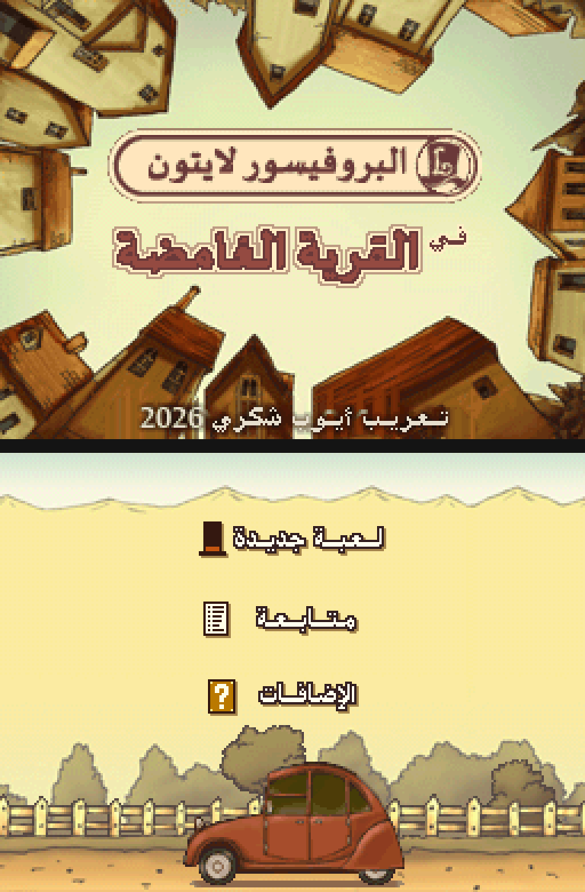
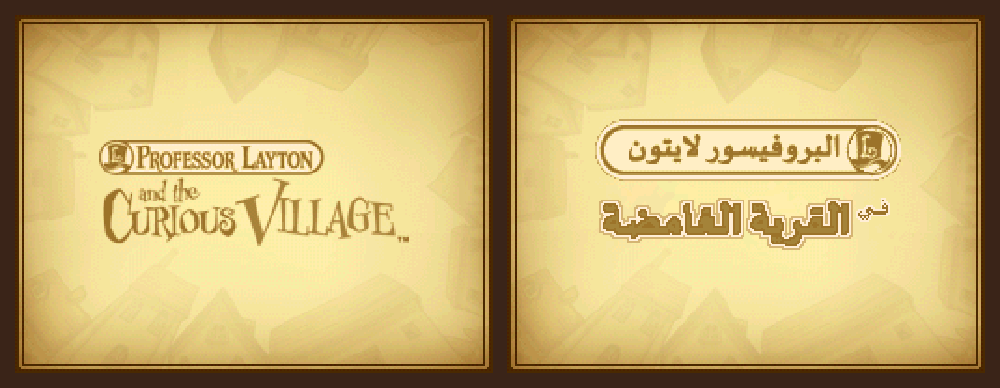
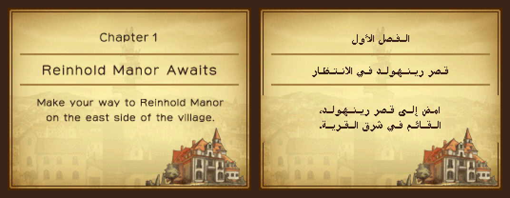
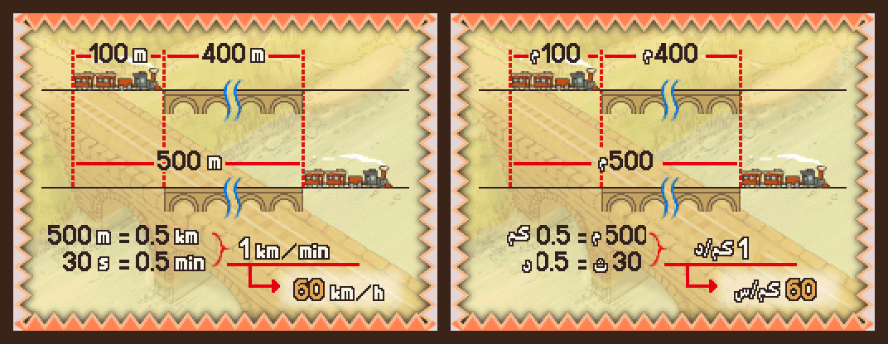
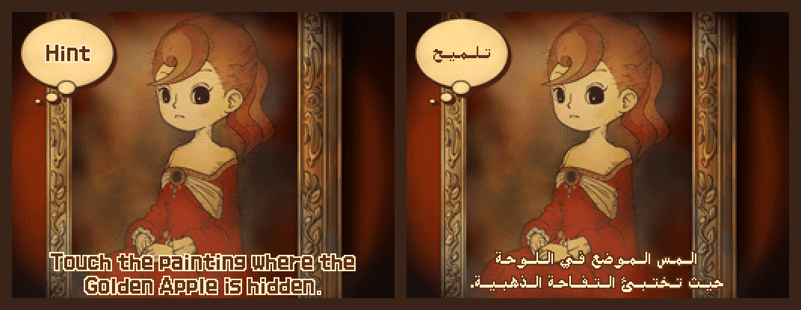
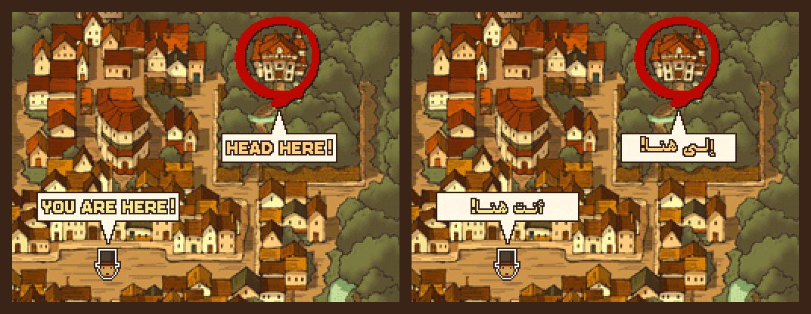

# البروفيسور لايتون في القرية الغامضة - النسخة العربية

**تعريب: أيوب شكري** · الإصدار 1.0 · نوفمبر 2026

ترجمة عربية كاملة لهواة اللعبة، لنسخة Nintendo DS الأوروبية من "Professor Layton and the Curious Village".

### [⬇ تحميل الرقعة (الإصدار 1.0)](https://github.com/SherlockedMain/Professor-Layton-and-the-Curious-Village/releases/latest)

## ما تمت ترجمته

- القصة والحوارات كلها، مكتوبة من اليمين إلى اليسار بخط عربي مصمم لشاشة الجهاز.
- الألغاز كلها: الأسئلة والتلميحات والإجابات وأسماء الألغاز.
- القوائم والشاشات: الشاشة الرئيسية، الحقيبة، المذكرات، فهرس الألغاز، الإضافات، التخزين، تحديات لايتون.
- الصور والرسوم التي فيها كتابة: شعار اللعبة، بطاقات الفصول، الصحف، الخريطة، الأبواب واللافتات، ووحدات القياس داخل صور الألغاز.
- لوحة مفاتيح عربية لكتابة الاسم.
- الترجمة المصاحبة للمقاطع المصورة.

## قبل وبعد

| | |
|:-:|:-:|
|  |  |
|  |  |
|  |  |

## طريقة التثبيت

1. احصل على نسخة اللعبة الأوروبية الأصلية من نسختك الخاصة:
   `Professor Layton and the Curious Village (Europe) (En,Fr,De,Es,It).nds`
2. حمّل الرقعة `Professor_Layton_Curious_Village_Arabic_OS.bps` من [صفحة الإصدارات](https://github.com/SherlockedMain/Professor-Layton-and-the-Curious-Village/releases/latest).
3. طبقها بأداة [ROM Patcher JS](https://www.marcrobledo.com/RomPatcher.js/) من المتصفح، أو بأداة Floating IPS (Flips) على الحاسوب.
4. شغل الملف الناتج على المحاكي أو على الجهاز.

## ملاحظات

- شاشة إعداد اتصال Nintendo Wi-Fi بقيت بالإنجليزية، فهي أداة نينتندو المدمجة لا جزء من اللعبة نفسها.
- في اللغز 33 (ألف مرة) الإجابة حرف إنجليزي، فبقي الحرفان m و mm في الصورة كما هما.
- جربت الترجمة على محاكي melonDS.

---

## English

**Professor Layton and the Curious Village - Arabic Translation**
Version 1.0 · November 2026 · Translation and ROM hacking: Ayoub Chakri

A complete fan translation into Arabic of the European Nintendo DS release: all story dialogue (right-to-left, with an Arabic pixel font made for the DS screen), every puzzle, the menus, the pictures with text in them, an Arabic name keyboard and the cutscene subtitles.

### [⬇ Download the patch (v1.0)](https://github.com/SherlockedMain/Professor-Layton-and-the-Curious-Village/releases/latest)

### How to patch

1. Use your own dump of `Professor Layton and the Curious Village (Europe) (En,Fr,De,Es,It).nds`.
2. Apply `Professor_Layton_Curious_Village_Arabic_OS.bps` with [ROM Patcher JS](https://www.marcrobledo.com/RomPatcher.js/) or Floating IPS (Flips).
3. Play the patched file on an emulator or on hardware.

### Checksums

| | Size | CRC32 | SHA-1 |
|---|---|---|---|
| Original ROM (required) | 134,217,728 bytes | `B1BB205B` | `0d6265c63a9a30c119fe933ca1abb91df66e97f1` |
| Patched ROM | 76,781,768 bytes | `26A8AEC7` | `482ad88ce32c41621c3ca4c1d46b73ee8390f185` |

The patched ROM is smaller because the empty padding at the end of the original file is dropped when the ROM is rebuilt.

### Notes

- The Nintendo Wi-Fi Connection setup screens stay in English: they are Nintendo's built-in utility, not part of the game.
- Puzzle 33 ("1,000 Times") keeps the Latin "m" and "mm", because the answer is a Latin letter.
- Tested on the melonDS emulator.

### Disclaimer

This is an unofficial, free fan translation, not affiliated with Level-5 or Nintendo. The patch contains no game data. Do not ask for or share ROMs; use your own copy of the game. "Professor Layton" and all related material belong to their owners.
